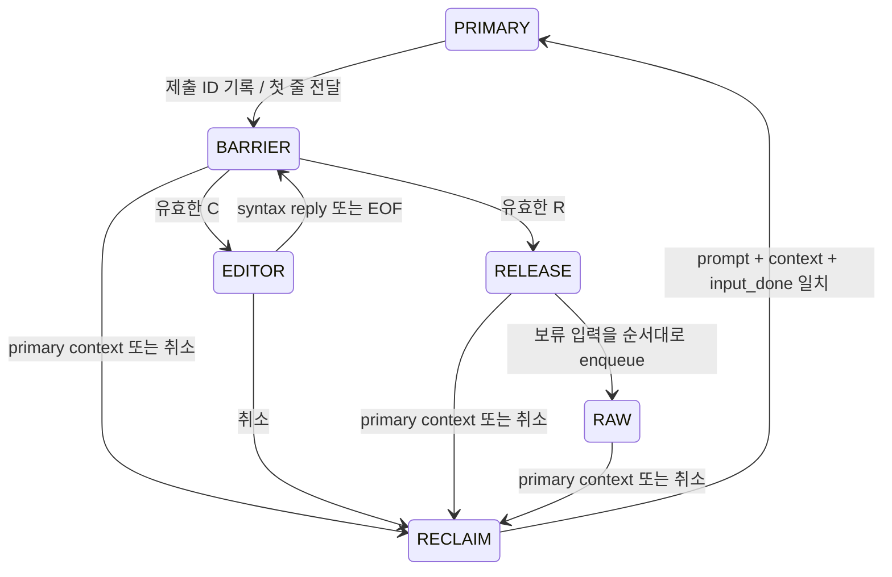

# 입력 요청과 PTK 편집

이 브랜치는 셸이 확인한 입력 경계를 공통 session 계약으로 연결한다. 현재 Bash와
zsh는 지원 조건이 충족되면 primary와 continuation 명령 편집을 PTK로 제공한다.
실제 경로를 검증한 버전은 **Bash 5.3.9와 zsh 5.9**다. 프로그램의 stdin과 Python
도구의 `input()`은 기존 native 입력 경로를 유지한다.

tcsh, BSD csh, sh/dash의 continuation은 아직 native다. 해당 셸의 관찰 결과와
부족한 보장은 [HANDOFF_LIMITS.md](HANDOFF_LIMITS.md)에 기록했다. 이 문서는
모든 지원 셸의 PTK continuation이나 전체 리팩토링 완료를 선언하지 않는다.

## 표시와 입력 권한

semantic 모드의 PS2는 private FIFO에 요청을 보내며 화면에 프롬프트를 출력하지
않는다. 확인된 syntax 요청을 받은 session이 PTK의 `> ` 편집기를 연다. 이미
primary PTK에서 제출한 multiline paste는 다시 편집하지 않고, 후속 요청마다
승인된 한 physical line씩 전달한다.

primary 표시는 기존 셸 프롬프트와의 호환성 및 `prompt_text` 사용자 설정을
유지한다. primary 표시까지 모두 새 디자인으로 바꾸거나 모든 셸 프롬프트를
신호 전용으로 교체한 상태는 아니다. 표시 문자열, 화면의 공백, process group,
read 호출 또는 일정 시간 출력이 없다는 관찰로 입력 권한을 결정하지 않는다.
production의 deadline은 전송·동기화 실패를 처리하기 위한 것이다.

## 서로 다른 identity

| 값 | 생성·소유 책임 | 의미 |
| --- | --- | --- |
| session token | session의 `SessionSignals` | 다른 세션의 제어 프레임을 구별한다. |
| submission ID (`sid`) | 공통 session의 `Handoff` | 실제 제출을 구별하는 증가 값이다. 첫 줄을 쓰기 전에 private 파일을 atomic replace한다. |
| request sequence (`seq`) | 셸 adapter의 integration | 같은 제출 안에서 발생한 C/R 요청을 구별한다. 새 제출에서 1부터 시작하고 각 요청마다 증가한다. |
| primary `prompt_id` | 기존 셸 integration | prompt 표시, context, 입력 회수 ACK가 같은 primary 경계에 속하는지 확인한다. |
| `EditRequest.id` | session의 `EditState` | PTK 편집 시도 하나를 구별하는 로컬 값이다. wire ID가 아니다. |
| `EditRequest.boundary` | session이 확인한 primary 경계 | 해당 편집 시도가 시작된 primary identity다. continuation에서도 마지막으로 확인한 primary를 가리킨다. |
| `EditRequest.wire` | session이 수락한 `InputRequest` | continuation 편집을 승인한 실제 `sid/seq/C` 요청이다. primary 편집에서는 `None`이다. |

같은 primary에서 Ctrl+C로 다시 편집하거나 Python 도구 실행 후 돌아오면
`prompt_id`는 같아도 로컬 편집 ID가 달라진다. 검증 실패로 같은 syntax 요청을
다시 편집하는 경우에도 wire 요청과 로컬 편집 시도를 구별한다. 로컬 응답은 현재
발급한 객체 한 번만 소비할 수 있으며, 복사본·취소된 시도·늦은 응답은 새 시도를
해제하지 못한다.

## Wire format

C/R과 capability는 기존 private context FIFO인 `_ish_pipe`를 사용한다. 기존
`ISH2` context 프레임과 함께 읽을 수 있는 ASCII category/body 프레임이다.

```text
<SOH>edit<US>1;<token>;<sid>;<seq>;C<EOT>
<SOH>edit<US>1;<token>;<sid>;<seq>;R<EOT>
<SOH>edit_mode<US>1;<token>;<prompt_id>;<0|1><EOT>
```

`SOH=0x01`, `US=0x1f`, `EOT=0x04`다. `1`은 이 요청 body의 버전이며 기존
context의 `ISH2` 버전과 별개다. token, 필드 수, 양의 bounded decimal ID,
request 종류를 먼저 검증한다. 현재 제출의 정확히 다음 sequence만 `BARRIER`에서
수락하며, 다른 세션·제출, 중복, 오래된 값, 순서가 맞지 않는 요청은 거부한다.

- **C / SYNTAX:** 셸 parser가 대화형 명령 구문의 다음 줄을 받을 경계다. PTK
  편집 또는 이미 제출된 구문 한 줄을 허용한다. ish 명령 dispatch 권한은 없다.
- **R / RAW:** native 입력 소비를 허용하는 경계다. 명령 실행이 이미 시작됐거나
  끝났다는 보고가 아니다. 셸 hook, expansion, builtin, 외부 프로그램의 stdin도
  이 권한 아래에서 소비될 수 있다.
- **edit_mode:** 다음 제출에 semantic 모드를 사용할 수 있는지 알린다. 각 primary의
  context 뒤, input-return helper 앞에서 전송한다. session은 같은 `prompt_id`의
  prompt/context/input-return 완료를 확인한 후에만 이 capability를 적용한다.

primary 복귀를 위해 별도 semantic P 프레임을 추가하지 않았다. 기존 prompt ID,
context, `input_done`의 상관관계를 재사용한다. schema와 허용 전이는
[handoff.py](../src/ish/shell/handoff.py), 로컬 편집 시도는
[edit.py](../src/ish/shell/edit.py)에 정의한다.

## 입력 소유권 전이



1. **BARRIER:** 첫 physical line 뒤의 입력을 보류한다. 이미 제출한 paste의 나머지,
   PTY에서 회수한 입력, PTY에 전달하지 않은 새 키를 구별한다. Python에서 셸
   문법을 분석해 C/R을 추측하지 않는다.
2. **EDITOR:** C 하나는 구문 한 줄의 응답을 허용한다. 추가 편집이 필요하면 실제
   `Prompt.prompt_async()`를 실행한다. `EditRequest.commands=False`이므로
   `probe`, `ish_exit` 같은 이름이나 heredoc 본문도 문자 그대로 셸로 전달한다.
   응답 검증이 끝난 뒤 요청을 소비하고 다음 `BARRIER`로 돌아간다.
3. **RELEASE:** R을 수락한 직후에도 새로운 native 키를 먼저 보내지 않는다. 기존에
   보류한 입력을 원래 순서로 writer에 넣은 뒤 **RAW**를 열어 새 입력이 앞서지
   않게 한다. 이 단계는 enqueue 순서를 보장하며 primary ACK의 writer drain과
   다른 역할을 갖는다.
4. **RECLAIM:** 새 primary context나 취소를 받으면 추가 전달을 중지한다. sender와
   PTY writer의 기존 쓰기를 완료한 뒤 해당 `prompt_id`를 ACK한다. 기존
   `_ish_forward` helper는 그동안 unread PTY 입력을 회수하고, ACK 뒤 한 번 더
   drain한 후 `input_done`을 보낸다. session은 같은 prompt/context/완료 identity와
   빈 writer를 확인한 뒤 primary 편집을 연다.

짧은 명령이 이미 끝난 뒤 부모가 R을 늦게 처리해도, 먼저 primary context를
받았다면 R을 거부한다. 이미 native로 전송한 suffix는 위 helper 경계에서 회수한다.
늦은 입력을 다음 셸 parser read로 흘리지 않기 위해 Bash/zsh에 별도의 두 번째
primary handshake를 추가하지 않았다.

R을 받은 뒤의 control key도 native PTY에 속한다. 이전 LR 관찰이 늦게 도착해도
그 관찰로 C 취소 절차를 다시 시작하지 않는다. 실제 `exec Python`이 원래 셸의
PID와 foreground process group을 그대로 쓰는 경우를 재현하고, LR(false)를
보류한 상태에서 SIGINT 한 번과 후속 입력의 정확한 파일 결과를 확인했다.
이 경우 기존의 관찰 우선 처리는 취소 ACK를 기다리다 실패했고, R 권한을
우선하는 현재 경로는 정상 종료했다.

현재 계약은 한 제출 안의 `C → reply → C` 반복과 마지막 R 뒤 primary 복귀를
지원한다. **실행 중 `RAW → syntax`로 돌아오는 전이는 허용하지 않는다.** tcsh의
명령 치환을 포함한 foreach 등에는 실제로 이 교대가 필요하며, 추가적인
`RAW → RECLAIM 완료 → C` 보장 없이 capability를 켤 수 없다.

## 셸별 구현과 fallback

| Adapter | 구문 요청 / native 권한 | 활성 조건과 확인한 환경 |
| --- | --- | --- |
| [Bash](../src/ish/shell/adapter/bash_edit.py) | PS2의 current-shell substitution에서 C, PS0 앞부분에서 R | Bash 5.3.9 이상, `promptvars`, 마지막 `PROMPT_COMMAND`가 ish hook. 실제 5.3.9 검증. |
| [zsh](../src/ish/shell/adapter/zsh_edit.py) | PS2의 math-function expansion에서 C, 기존 preexec의 reader 해제 뒤 R | `PROMPT_SUBST`, ZLE 비활성, ish가 소유한 `TRAPINT`와 preexec wrapper의 일치. 실제 5.9 검증. |
| tcsh / BSD csh / sh-dash | 새 C/R capability 비활성 | 기존 primary 편집과 native continuation 유지. [제약과 재현](HANDOFF_LIMITS.md) 참고. |

Bash는 사용자 PS0를 보존하며 그 앞에 R 보고를 배치한다. promptvars가 꺼지거나
ish 뒤에 다른 PROMPT_COMMAND hook이 있으면 wrapper를 제거하고 native 모드를
보고한다. 최소 버전 gate가 있다는 사실은 그 아래 버전의 기존 경로까지 지원한다는
뜻이 아니다.

zsh는 기존 preexec/precmd hook과 종료 상태 전달을 유지한다. 사용자 `TRAPINT`를
덮어쓰지 않으며 필요한 interrupt/reader acknowledgement를 소유하지 못하면 native로
돌아간다. semantic PS2에는 `zsh/zselect`가 필요 없다. 해당 모듈은 native fallback의
반복 prompt 표시를 줄이는 기존 기능에 사용한다. zsh 5.5.1이라는 기존 최소 지원
안내와 새 semantic 경로의 5.9 실측은 구별한다.

## 취소, EOF, 기존 API

- primary Ctrl+C는 로컬 편집을 취소하고 같은 확인된 경계에서 새 시도를 연다.
  primary의 빈 편집기에서 Ctrl+D는 session을 종료하며 CLI exit status는 0이다.
- syntax Ctrl+C는 해당 요청과 제출의 남은 입력을 폐기하고 현재 PTY의 `VINTR` 및
  adapter의 기존 signal 정책을 사용한다. zsh의 LI acknowledgement 의미와 처리
  순서는 기존 handler에 남아 있다. 공통 편집기가 임의의 release newline을 만들지
  않는다. 뒤따른 새 키와 회수된 native 키의 출처도 보존한다.
- syntax의 빈 편집기에서 Ctrl+D는 현재 요청을 소비하고 PTY에 설정된 `VEOF`를
  보낸다. heredoc 종료나 불완전 구문의 처리는 셸이 결정한다.
- validation 실패는 전송 전에 처리한다. 첫 줄을 보내기 전 lease 획득이 실패하면
  확인된 primary와 입력 순서를 복원한다. syntax reply가 거절되면 같은 wire 요청을
  유지한 채 편집을 다시 연다.
- PTY EOF가 자식 종료 통지보다 빠르면 실제 프로세스 결과를 기다린다. 실패한
  편집 요청으로 native 종료 코드나 마지막 출력을 덮어쓰지 않는다.

session은 `Prompt.prompt_async()`로 텍스트를 받은 뒤 승인된 primary 제출만
dispatch한다. `Prompt.read_and_dispatch()`는 기존 호출자를 위해 남아 있지만
이를 override해도 live session 경로는 바뀌지 않는다. custom editor는
`prompt_async()`에서 직접 dispatch하지 않고 텍스트를 반환해야 한다. 기존
pre-execution → execution → post-execution → fallback 순서는 유지한다.

공통 확장은 [engine.py](../src/ish/shell/engine.py)의 session과 입력 계약에 있다.
PTK Application이나 공통 입력 처리에 Bash/zsh 이름별 분기를 추가하지 않았다.
별도 InputRouter를 도입한 변경도 아니다. adapter가 조건과 셸 경계를 해석하고,
session이 보류·전송·회수·요청 수명을 집행한다. Bash PS0 및 zsh math function,
preexec/LI 같은 구현 차이는 adapter/session 경계 안에서 처리한다.

## 검증과 단계 상태

실제 검증 환경은 Linux/WSL, Python 3.12.14, prompt-toolkit 3.0.53, Bash 5.3.9,
zsh 5.9다. 아래 테스트는 wire 관찰, 계약 검증, 실제 PTK 경로를 구분한다.

```sh
# 공통 wire/state 계약, 로컬 편집 시도, dispatch
PYTHONPATH=src:tests uv run python -B -m unittest \
  test_handoff_protocol test_edit_requests test_edit_dispatch

# 실제 셸 PTY에서 C/R ordering, native stdin 및 회수 경계 관찰
PYTHONPATH=src:tests uv run python -B -m unittest \
  test_bash_edit_protocol test_zsh_semantic

# 실제 ish CLI + PTK에서 편집 소유권, 최종 소비자와 파일 결과 확인
PYTHONPATH=src:tests uv run python -B -m unittest \
  test_semantic_edit_cli test_zsh_edit_cli test_semantic_races

# 기존 키 입력 및 hook/status 회귀
PYTHONPATH=src:tests uv run python -B -m unittest \
  test_native_cursor_keys test_p2_shells
```

검증 항목은 fast typeahead의 C/R/primary 분기, multiline paste, heredoc의
공백·Unicode·도구 이름, builtin read, 외부 stdin, Python input(), source 및
명령 치환, Ctrl+C/D, 지연·중복·취소된 wire 요청과 ACK, 늦은 R 처리 및 primary
입력 회수를 포함한다. 실제 PTK 테스트는 key binding의 활성 편집 요청과 buffer를
관찰하고 파일 결과를 함께 확인한다. 관찰용 문자열이나 실패 deadline을 production
readiness로 사용하지 않는다. 세부 testcase는 각 파일이 확인하는 보장의 범위다.

| 단계 | 현재 상태 |
| --- | --- |
| 1. 작업 분리·규칙·편집과 dispatch 분리 | 완료 |
| 2. primary 편집 요청 수명 관리 | 완료 |
| 3. 공통 wire 계약·보류/회수·PTK syntax UI 연결 | Bash/zsh 실제 경로에서 구현·검증 완료; primary 표시 호환성 유지 |
| 4. Bash PTK continuation | 위 지원 조건과 시나리오에서 구현·검증 완료 |
| 5. zsh PTK continuation | 위 지원 조건과 시나리오에서 구현·검증 완료 |
| 6. tcsh handoff 및 continuation | 경계 재현 및 별도 [FIFO/PTY 분리 실험](CHANNEL_EXPERIMENT.md) 확보. 실험용 read gate와 제한된 회수 검증; production 연결과 live PTK 전환 미구현 |
| 7. BSD csh·sh/dash 적용 | 제약 조사 완료. live PTK continuation 비활성 |
| 8. 기존 처리 정리·전체 회귀·지원 문서 | 구현한 범위의 정리·회귀·문서 완료. 6~7단계가 남아 있어 전체 8단계 완료가 아님 |

tcsh의 기존 read-ahead preload나 native 입력 방어를 제거하지 않았다. VT emulator와
Windows 네이티브/macOS 이식은 이 작업 범위 밖이다. 모든 셸의 continuation을 PTK로
제공하는 최종 목표에는 6~7단계의 추가 native 경계와 검증이 남아 있다.
